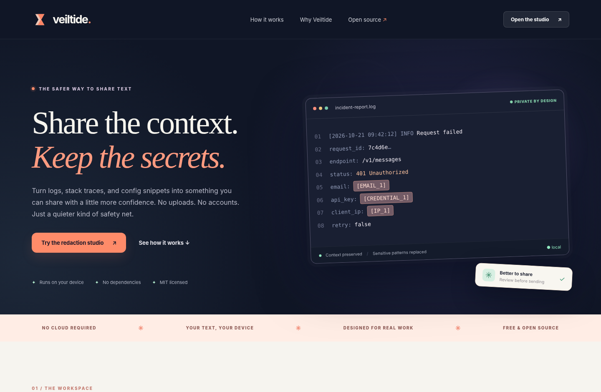

<div align="center">
  
  <h1>Veiltide</h1>
  <p><strong>Share the context. Keep the secrets.</strong></p>
  <p>A local-first, open-source redaction studio and CLI for logs, stack traces, support tickets, and snippets.</p>
  <p><a href="#quick-start">Quick start</a> · <a href="#what-it-detects">Detection</a> · <a href="docs/DEPLOYMENT.md">Deployment</a> · <a href="SECURITY.md">Security</a> · <a href="CONTRIBUTING.md">Contribute</a></p>
</div>



## Features

- **Use it immediately.** A responsive redaction studio with a live before/after preview, sample data, keyboard support, drag-and-drop import, and copy/download controls.
- **No uploads or sign-ups.** The app contains no analytics, cloud API, or runtime dependencies. Text is never persisted to browser storage.
- **Predictable placeholders.** Replace repeated matches with stable labels such as `[EMAIL_1]`, `[TOKEN_1]`, or `[CREDENTIAL_1]` to preserve debugging context.
- **Adjustable privacy.** Toggle categories and enter up to 20 custom literal phrases to mask.
- **A real CLI.** Process files or stdin, opt out of individual detectors, view safe aggregate counts, and save output to a protected file.
- **Installable PWA.** After loading from HTTPS, the static app shell can work offline.
- **Built for review.** False negatives are possible; the UI tells you to inspect the output before sharing.

## Quick start

Requirements: Node.js 22+ for local serving and CLI use. No runtime dependencies.

```bash
npm ci
npm run dev
```

Open `http://localhost:4173` in your browser. You can also upload the built static site to an HTTPS static host.

```bash
npm run verify
# Static website in dist/
```

### Command line

```bash
node src/cli.js --help
node src/cli.js my-output.log --report
cat my-output.log | node src/cli.js --report > safer-to-share.txt
node src/cli.js my-output.log --out safer-to-share.txt
```

The CLI will not overwrite an existing output file without `--force`. To protect privacy, `--report` prints only category counts and does not echo matched values. Input remains unchanged.

## What it detects

| Category | Examples | Caveats |
| --- | --- | --- |
| Credentials | Password assignments, bearer tokens, common token prefixes, private-key blocks, URL passwords | Unknown formats and multiline secrets may be missed |
| Emails | Common email-address shapes | Unusual international addresses may be missed |
| IP addresses | IPv4 | Does not cover IPv6 |
| Local paths | User names in common macOS, Linux, and Windows home paths | Arbitrary directory paths are not identified |
| Payment cards | Luhn-valid 13–19 digit numeric patterns | Validation is not proof a number is a real card |
| Custom terms | Exact phrases the user selects | Case-insensitive literal comparison |

Detectors are heuristics. **Never treat a zero-findings result as proof that a document is safe to share.** The privacy design prevents uploading input to this app's backend; it does not protect against a compromised browser, malicious extension, or user action that copies original text. Previously leaked credentials need rotation.

## Architecture

```text
src/redact.js  → pure deterministic engine (UI and CLI)
src/app.js     → browser interaction and explicit exports
src/cli.js     → stdin/file-oriented CLI, no network calls
scripts/       → development server and static build
assets/        → original branding, previews, social card
.github/       → CI, issue and PR templates
```

Security headers for Cloudflare Pages/Netlify-style deployments are supplied in `_headers`. GitHub Pages does not apply that file; deploy where you can enforce the documented CSP. See [deployment notes](docs/DEPLOYMENT.md).

## Tests

```bash
npm run test
npm run build
```

The test suite covers pattern behavior, overlap precedence, safe CLI output, input limits, and production-server constraints. Full production-browser and cross-browser testing remains part of the release checklist in `docs/TESTING.md`.

## Roadmap

See [ROADMAP.md](docs/ROADMAP.md) for incremental improvements. Suggestions and small, focused pull requests are welcome.

## License

[MIT](LICENSE). Copyright 2026 Veiltide contributors.
